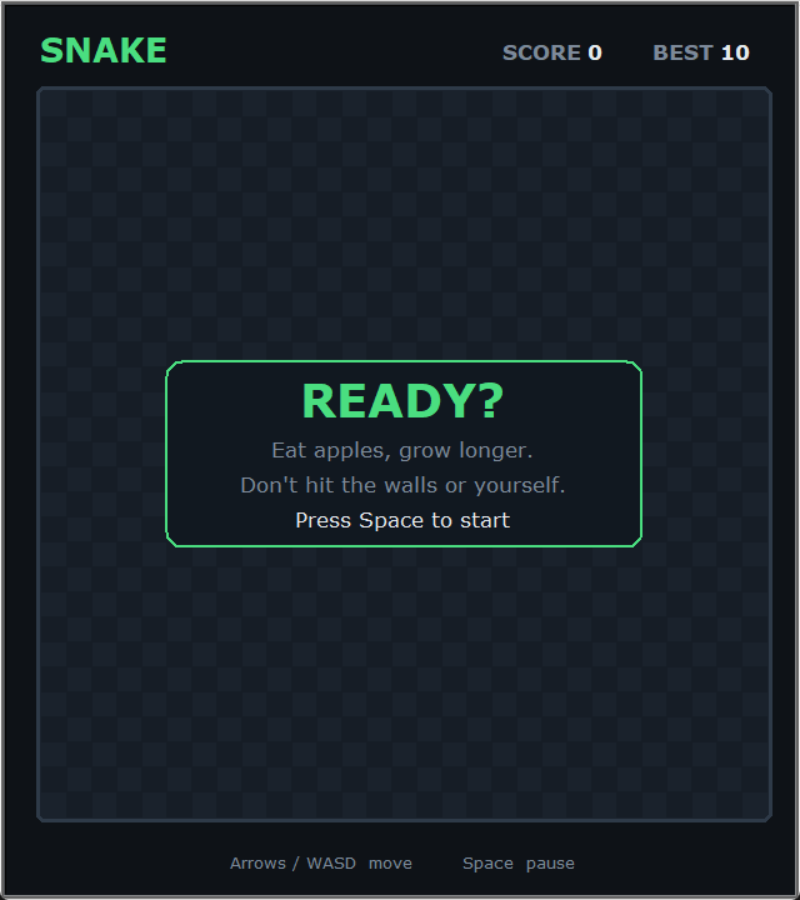
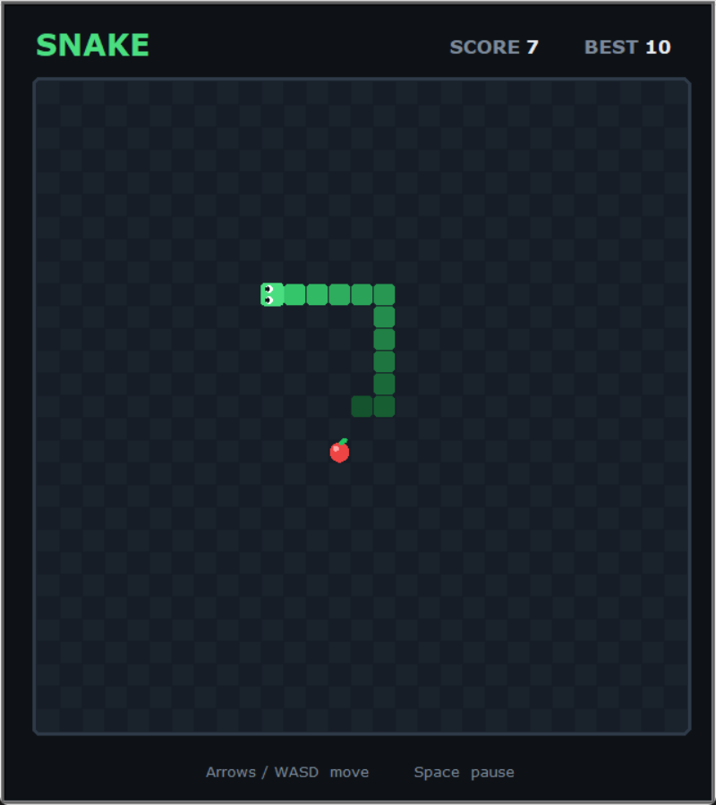
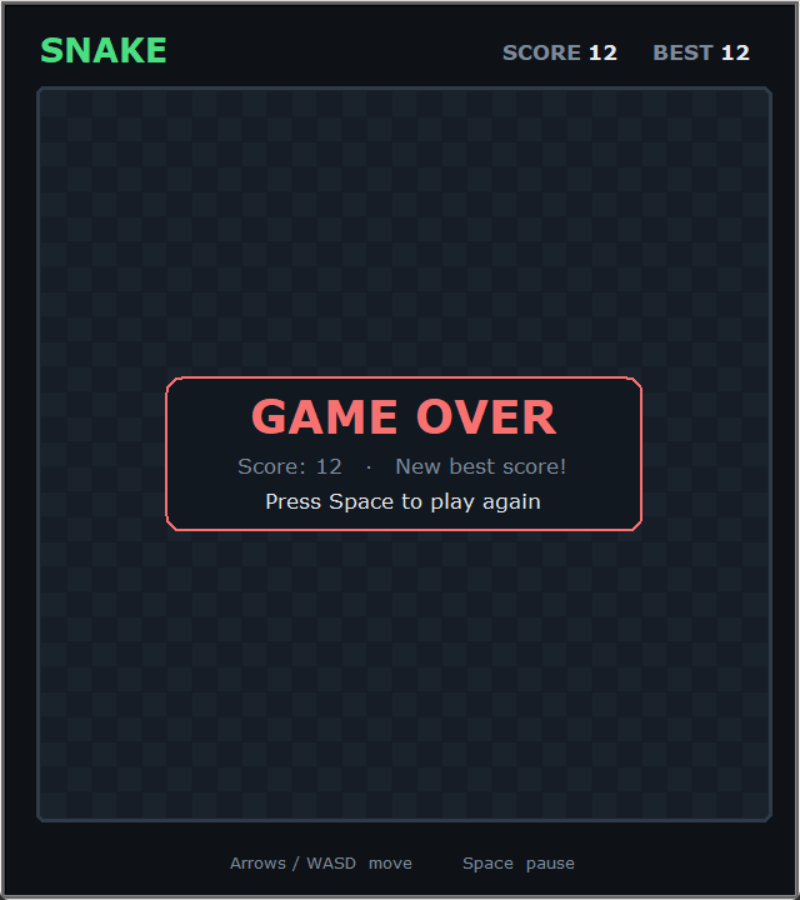

# 🐍 Snake Game

A classic Snake Game built using **Python** and the **Turtle Graphics** library. Control the snake, eat food to grow longer, beat your high score, and avoid crashing into the walls or your own tail.

---

## 🎮 Features

* Classic Snake gameplay on a checkered board
* Snake with a face and a body that shades darker towards the tail
* Pulsing apple that never spawns on the snake
* Start, pause and game-over screens
* Arrow keys or WASD controls
* Score and best score shown at the top; best score saved locally
* Clean object-oriented Python code

---

## 📂 Project Structure

```
snake_game/
│── main.py           # Main game loop
│── snake.py          # Snake class and movement logic
│── food.py           # Food generation
│── scoreboard.py     # Score and high score management
│── ui.py             # Board, custom shapes and message overlays
│── theme.py          # Colours, fonts and layout sizes
│── Assets/           # Screenshots
└── README.md
```

The high score is saved to `data.txt`, which the game creates automatically next to `scoreboard.py`.

---

## 🛠️ Technologies Used

* Python 3
* Turtle Graphics
* Object-Oriented Programming (OOP)

---

## ▶️ How to Run

1. Clone the repository:

```bash
git clone https://github.com/CodeCopAkash/snake_game.git
```

2. Navigate to the project folder:

```bash
cd snake_game
```

3. Run the game:

```bash
python main.py
```

> Make sure Python 3 is installed. The Turtle module comes pre-installed with Python.

---

## 🎯 Controls

| Key        | Action                          |
| ---------- | ------------------------------- |
| ↑ or W     | Move Up                         |
| ↓ or S     | Move Down                       |
| ← or A     | Move Left                       |
| → or D     | Move Right                      |
| Space      | Start / Pause / Resume / Replay |

---

## 🕹️ Gameplay

* Press Space to start.
* Eat the apple to increase your score.
* Every apple collected makes the snake grow longer.
* Hitting the wall or your own tail ends the game. Press Space to play again.
* Your highest score is saved to `data.txt` as soon as you beat it.
* Food never spawns on top of the snake.

---

## 📸 Screenshots

| Start | Gameplay | Game over |
| --- | --- | --- |
|  |  |  |

---

## 📚 Concepts Practiced

* Classes and Objects
* Inheritance
* Event Handling
* Collision Detection
* File Handling
* Game Loop
* Turtle Graphics

---

## 🚀 Future Improvements

* Sound effects
* Difficulty levels
* Obstacles

---

## 🤝 Contributing

Contributions are welcome! Feel free to fork this repository, improve the game, and submit a pull request.

---

## 📄 License

This project is licensed under the MIT License.

---

### ⭐ If you enjoyed this project, consider giving it a star on GitHub!
